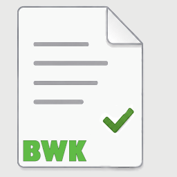
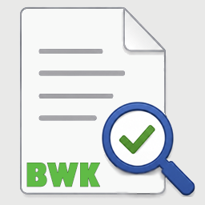

# Die Manifest Desktop-Apps *ManifestCreate* und *ManifestCheck*

Das Verzeichnis ManifestDesktopApp enthält den C#-Code für die Windows-Desktop-Applikationen  
**ManifestCreate** 
  und  
**ManifestCheck** .
 
 
Das Verzeichnis [**ManifestLibrary**](ManifestLibrary) enthält Code, der gemeinsam von [**ManifestCreate**](ManifestCreate) und [**ManifestCheck**](ManifestCheck) verwendet wird.
 
 
Bei der Erstellung des Manifests werden Dateien mit den Namen Thumbs.db und desktop.ini sowie sämtliche Dateien und Verzeichnisse, deren Name mit einem Punkt beginnt, nicht berücksichtigt. 
Diese Regel gilt unabhängig vom Betriebssystem und wird auch bei der Prüfung auf zusätzliche Dateien angewendet.

---

Developed by: Bernhard Simon Bock 
Published on GitHub by: Bund der Ingenieure für Wasserwirtschaft, Abfallwirtschaft und Kulturbau ([BWK](https://www.bwk-bund.de/)), Germany 
License: MIT 
