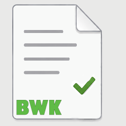
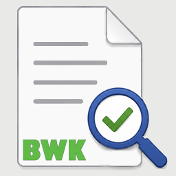

# Die Manifest Desktop-Apps *ManifestCreate* und *ManifestCheck*

Das Verzeichnis ManifestDesktopApp enthält den C#-Code für die Windows-Desktop-Applikationen  
**ManifestCreate** 
  und  
**ManifestCheck** .
 
 
Das Verzeichnis [**ManifestLibrary**](ManifestLibrary) enthält Code, der gemeinsam von [**ManifestCreate**](ManifestCreate) und [**ManifestCheck**](ManifestCheck) verwendet wird.

---

Developed by: Bernhard Simon Bock 
Published on GitHub by: Bund der Ingenieure für Wasserwirtschaft, Abfallwirtschaft und Kulturbau ([BWK](https://www.bwk-bund.de/)), Germany 
License: MIT 
