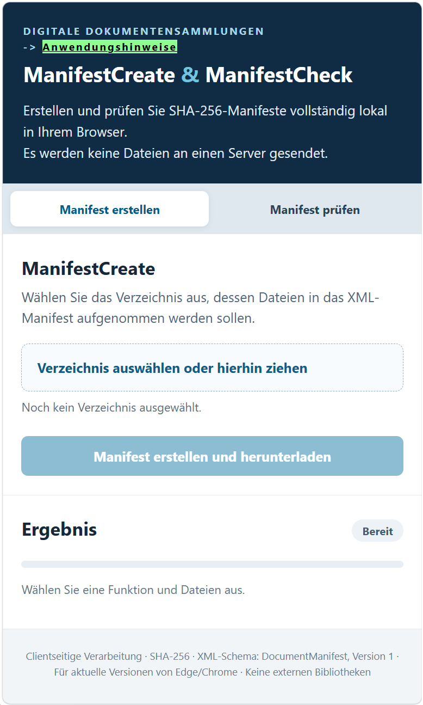

# ManifestCreate / ManifestCheck – Browser-Version
Die vorliegende HTML-Anwendung ist eine beispielhafte Implementierung des im Fachartikel "Das digitale Original als Ersatz für analoge Mehrausfertigungen", Wasser und Abfall, Heft 11/2026, Verlag Springer Fachmedien Wiesbaden GmbH beschriebenen Verfahrens zur Erstellung und Prüfung von SHA-256-Manifestdateien für digitale Dokumentensammlungen.

. 

## Verwendung von *ManifestCreate* (Erzeugung einer Manifest-Datei)
  **"Manifest erstellen"** ist die Standard-Einstellung dieser Browser-Anwendung. Falls sie nicht hell hinterlegt ist, klicken Sie zunächst auf **"Manifest erstellen"**.
  Wählen Sie  ein Verzeichnis auf ihrem PC durch Anklicken aus oder ziehen sie das Verzeichnis auf die Schaltfläche. 
  Klicken Sie danach "Manifest erstellen und herunterladen". 
  Es erscheint eine neue Schaltfläche "XML-Manifest herunterladen", womit Sie das erzeugte XML-Manifest herunterladen könnnen. 
  Der Dateiname des XML-Manifests lautet `<Verzeichnis>.sha256.<SHA256>.xml`. 
   
  Bei dem Browser *Microsoft-Edge* (Windows) wird eine Warnmeldung beim Download der XML-Manifestdatei ausgegeben. 
  Bei den Browsern *Google-Chrome* (Linux und Windows) und *Mozilla Firefox* (Linux und Windows) ist ein direkter Download der XML-Manifestdatei möglich. 

## Verwendung von *ManifestCheck* (Dokumentensammlung mit Manifest vergleichen)
  Klicken Sie zunächst auf **"Manifest prüfen"**.
  Wählen Sie XML-Manifestdatei und Datenverzeichnis aus und starten Sie danach die Prüfung. 
  Das Ergebnis wird angezeigt und das Protokoll kann heruntergeladen werden. 

## Datenschutz
  Die Seite verwendet keine externen Skripte, keine Uploads, keine Netzwerkanfragen und keine Analyse-Dienste. Die Dateien bleiben lokal.

## Kompatibilität
  - XML-Elemente und Attribute entsprechen der XML-Strukur in den C#-Programmen DocumentManifest, ManifestVersion=1, HashAlgorithm=SHA-256, d.h. Document mit Index/Name/Hash/Size.
  - ManifestCheck verifiziert den SHA-256 über die Bytes der XML-Datei.
  - Damit können C#-erzeugte XML-Dateien geprüft werden, ohne dass sie neu serialisiert werden müssen.
  - ManifestCreate erzeugt eigene, schema-kompatible XML-Bytes, dessen SHA256-Code für den Dateinamen verwendet wird.
  - Die XML-Bytefolge ist nicht garantiert identisch zur Ausgabe des .NET (C#)XmlSerializer (u.a. Kommentar/Whitespace/Attributreihenfolge).

## Technische Hinweise
  - Rekursive Verzeichnisauswahl über webkitdirectory (Edge/Chrome).
  - SHA256 blockweise mit eigenständiger JavaScript-Implementierung.
  - Keine Verzeichnisse ohne Dateien im Manifest (wie beim C#-Original).
  - Die Browser-Downloadfunktion schreibt nicht automatisch neben den ausgewählten Verzeichnisordner. Der Speicherort ist vom Browser abhängig.
  - Die Verzeichnisauswahl erfordert die ausdrückliche Benutzerfreigabe.
  - Browser-Sicherheitsgrenzen verhindern direktes Überschreiben von Dateien.

## Start-Datei (Angaben zur Einrichtung auf einem homepage-Verzeichnis)
  Start-Datei ist index.html. Sie kann mit Microsoft Edge oder Google Chrome geöffnet werden. 
  index.html wird automatisch aufgerufen, wenn man die URL aufruft, in der sich index.html befindet. 
  Alle vier Dateien (index.html, style.css, sha256.js, app.js) müssen im gleichen Ordner liegen. 
  Es ist keine Installation und kein Server erforderlich. 
  Die Anwendung ist auch auf einem lokalen Dateiverzeichnis lauffähig. 

In diesem Verzeichnis befinden sich die erfoderlichen Dateien für **ManifestCreate** and **ManifestCheck** als WebApp.

- index.html
- app.js
- sha256.js
- style.css

---

Developed by: Bernhard Simon Bock 
Published on GitHub by: Bund der Ingenieure für Wasserwirtschaft, Abfallwirtschaft und Kulturbau ([BWK](https://www.bwk-bund.de/)), Germany 
License: MIT 
